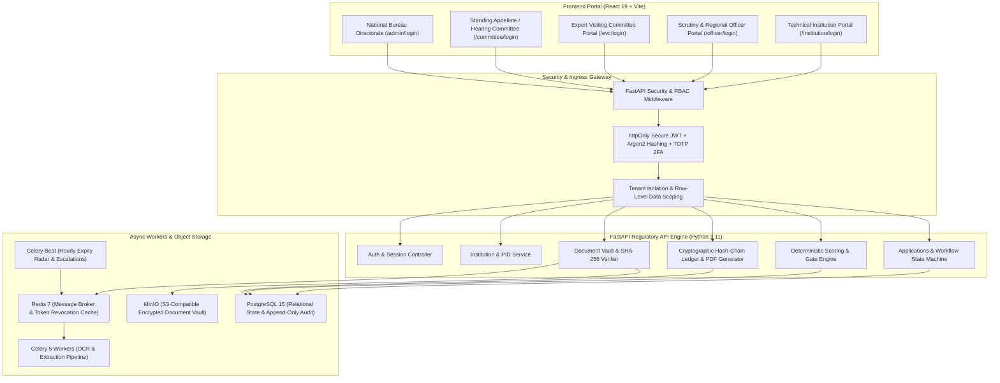

# AICTE Integrated Approval Workflow Automation, Compliance Monitoring and Alert Management System
### Statutory Regulatory Automation Platform Conforming to Approval Process Handbook (APH 2024–27)
*Statutory Body Under Department of Higher Education, Ministry of Education, Government of India*

---

[](https://fastapi.tiangolo.com)
[](https://react.dev)
[](https://vitejs.dev)
[](https://www.python.org/)
[](https://www.postgresql.org/)
[](https://www.docker.com/)
[](https://docs.pytest.org/)
[](file:///apps/api/core/security.py)

---

## ⚡ Quick Start & Live Access

- **Frontend Development Portal**: [http://localhost:5173/](http://localhost:5173/)
- **FastAPI OpenAPI Documentation**: [http://localhost:8000/docs](http://localhost:8000/docs)
- **GitHub Repository**: [https://github.com/Sanskar-soni04/Cosmos.git](https://github.com/Sanskar-soni04/Cosmos.git)

---

## 📜 Table of Contents

1. [Executive Summary & Regulatory Framework](#-executive-summary--regulatory-framework)
2. [Non-Negotiable Regulatory Principles](#-non-negotiable-regulatory-principles)
3. [System Architecture](#-system-architecture)
4. [Dedicated Role Portals & Credentials](#-dedicated-role-portals--credentials)
5. [Core Implemented Modules](#-core-implemented-modules)
   - [Deterministic Scoring & Mandatory Gate Engine](#1-deterministic-scoring--mandatory-gate-engine)
   - [Role-Based Access Control (RBAC) & Tenant Isolation](#2-role-based-access-control-rbac--tenant-isolation)
   - [Live Document Vault & SHA-256 Integrity](#3-live-document-vault--sha-256-integrity)
   - [Deficiency Lifecycle & Instant Re-verification](#4-deficiency-lifecycle--instant-re-verification)
   - [Append-Only Cryptographic Audit Trail](#5-append-only-cryptographic-audit-trail)
   - [Executive Scrutiny, Regional Heatmaps & EVC Panel](#6-executive-scrutiny-regional-heatmaps--evc-panel)
6. [Repository Structure](#-repository-structure)
7. [Local Setup & Installation](#-local-setup--installation)
8. [Automated Testing Suite](#-automated-testing-suite)
9. [Enterprise Production Roadmap](#-enterprise-production-roadmap)

---

## 🏛️ Executive Summary & Regulatory Framework

The **AICTE Integrated Approval Workflow Automation System** is an enterprise-grade regulatory processing engine designed to streamline, accelerate, and audit the approval and compliance monitoring cycle for technical educational institutions across India.

Operating strictly under the mandates of the **AICTE Approval Process Handbook (APH 2024–27)**, the platform replaces fragmented manual evaluation with:
- Automated pre-scrutiny powered by multi-specialist verification agents.
- Server-side deterministic weighted scoring with absolute statutory gate enforcement.
- Cryptographic hash-chained audit logging ensuring non-repudiation for statutory orders.
- Role-isolated workspaces for Technical Institutions, Scrutiny Officers, Regional Offices (RO), Expert Visiting Committees (EVC), Standing Hearing Committees (SHC), and the National Bureau Directorate.

---

## ⚖️ Non-Negotiable Regulatory Principles

The platform's architecture enforces five statutory axioms that cannot be bypassed:

```
┌─────────────────────────────────────────────────────────────────────────────────┐
│                           NON-NEGOTIABLE AXIOMS                                 │
├─────────────────────────────────────────────────────────────────────────────────┤
│ 1. AI SUPPORTS, NEVER DECIDES:                                                  │
│    AI models extract, verify, and highlight discrepancies. Final statutory      │
│    orders (Approval, Rejection, Deficiency Notice) require human sign-off with │
│    cryptographic signature and audited rationale.                               │
│                                                                                 │
│ 2. SINGLE SOURCE OF TRUTH (SERVER-SIDE):                                        │
│    All document findings, compliance scores, and approval statuses are          │
│    computed deterministically on the server from raw records. No client-side   │
│    or hardcoded scores are permitted.                                           │
│                                                                                 │
│ 3. MANDATORY GATE IS INDEPENDENT OF SCORE:                                      │
│    A quantitative score of 95/100 CANNOT override a failed statutory gate       │
│    (e.g., expired Fire Safety NOC, unverified Land Title).                      │
│    ANY mandatory rule != PASS => Mandatory Gate is BLOCKED.                    │
│                                                                                 │
│ 4. UNCERTAINTY IS NEVER PASS:                                                   │
│    Low-confidence extractions, unreadable scans, or mismatched records are      │
│    marked EXTRACTION_ERROR or REVIEW_REQUIRED, generating a human review task. │
│    Documents default to UPLOADED_PENDING until verified.                        │
│                                                                                 │
│ 5. IMMUTABLE APPEND-ONLY AUDIT LEDGER:                                          │
│    Every upload, verification, scoring update, and officer remark writes an     │
│    immutable record with SHA-256 seal linked to the preceding event hash.       │
└─────────────────────────────────────────────────────────────────────────────────┘
```

---

## 🏗️ System Architecture

The solution uses a decoupled, high-performance architecture built for statutory compliance, high concurrency, and horizontal scalability:



---

## 🔐 Dedicated Role Portals & Credentials

The portal features dedicated, role-tailored authentication entry points enforcing strict separation of duties:

| Portal | URL Route | Default Test Username | Default Password | Role & Scope |
|---|---|---|---|---|
| **🏛️ Technical Institution** | `/institution/login` | `INST-PUNE-8492` | `password123` | **INSTITUTE**: Single-institution scoped access. Profile, Document Vault, Application intake, Deficiency Cure, Instant Re-verification. |
| **🛡️ Scrutiny & Regional Officer** | `/officer/login` | `AICTE-OFFICER-01` | `adminpassword` | **REGIONAL_OFFICER**: Regional applications queue (WRO), side-by-side OCR verification, deficiency issuance, SLA timers. |
| **🔍 Expert Visiting Committee** | `/evc/login` | `EVC-EXPERT-01` | `evcpassword` | **EVC_EXPERT**: Assigned inspection schedules, conflict-of-interest declarations, geo-tagged photo review, on-site assessment reports. |
| **⚖️ Standing Hearing Committee** | `/committee/login` | `COMMITTEE-CHAIR` | `committeepassword` | **COMMITTEE_MEMBER**: Quasi-judicial hearing queue, appeal reviews, multi-agent evidence synthesis, statutory recommendation orders. |
| **🏛️ Bureau & National Admin** | `/admin/login` | `AICTE-DIR-01` | `superadminpass` | **BUREAU_OFFICER**: Pan-India institutional heatmaps, national pendency tracking, APH policy rules configuration, tamper-evident audit ledger. |

> **Note on Quick Login**: For demo convenience, each login portal includes one-click quick-fill buttons for immediate evaluation.

---

## ⚙️ Core Implemented Modules

### 1. Deterministic Scoring & Mandatory Gate Engine
Implemented in [`apps/api/services/scoring.py`](file:///c:/CODE/COSMOOS/apps/api/services/scoring.py) and mirrored in [`src/utils/rulesEngine.js`](file:///c:/CODE/COSMOOS/src/utils/rulesEngine.js).

The scoring model is governed by the 6 core statutory domains defined in the Approval Process Handbook:

```
┌─────────────────────────────────┬──────────┬───────────┬─────────────────────────────────────────┐
│ Regulatory Domain               │ Max Pts  │ Mandatory │ Governing APH 2024–27 Clause            │
├─────────────────────────────────┼──────────┼───────────┼─────────────────────────────────────────┤
│ 1. Land & Building Compliance   │  20 pts  │    YES    │ Clause 2.1 (Title, Mutation, Occupancy) │
│ 2. Fire & Life Safety           │  20 pts  │    YES    │ Clause 4.2 (Valid Municipal Fire NOC)   │
│ 3. Faculty Cadre & Ratio        │  20 pts  │    YES    │ Clause 7.1 (1:15 Cadre, Verified IDs)   │
│ 4. Financial Stability & FDR    │  15 pts  │    NO     │ Clause 3.4 (Joint FDR & Endowment Fund) │
│ 5. Academic Labs & Equipment    │  15 pts  │    NO     │ Clause 6.3 (Instructional Area Norms)   │
│ 6. Statutory Approvals & Legal  │  10 pts  │    NO     │ Clause 1.8 (Affiliating University NOC) │
├─────────────────────────────────┼──────────┼───────────┼─────────────────────────────────────────┤
│ Total Quantitative Score        │ 100 pts  │           │ Minimum 75 required for normal queue    │
└─────────────────────────────────┴──────────┴───────────┴─────────────────────────────────────────┘
```

#### Scoring Rules:
- `PASS` = Earns full category weight.
- `FAIL_DEFICIENCY` or `MISSING` = Earns `0` points.
- `REVIEW_REQUIRED` or `EXTRACTION_ERROR` = Unverified. Excluded from earned score and explicitly tracked in `unverified_items` (does not fail the category, but cannot contribute points until verified).
- **Mandatory Statutory Gate**: If ANY mandatory rule is != `PASS`, `mandatory_gate_status` is locked to `"BLOCKED"` with itemized `blocking_reasons`.

---

### 2. Role-Based Access Control (RBAC) & Tenant Isolation
Implemented in [`apps/api/core/rbac.py`](file:///c:/CODE/COSMOOS/apps/api/core/rbac.py) and [`apps/api/core/security.py`](file:///c:/CODE/COSMOOS/apps/api/core/security.py).

- **JWT Session Tokens**: Distributed exclusively via secure `httpOnly`, `samesite="lax"` cookies (`access_token`), immune to client-side XSS exfiltration.
- **Strict Row-Level Scoping**: Institutions can ONLY query and mutate records matching their authenticated `institution_id`. Any attempt to access another institution returns `403 Forbidden`.
- **Officer Endpoint Protection**: Non-officer roles attempting to access `/api/v1/officer/*` are rejected with `403 Forbidden`.
- **Regional Queue Scoping**: Regional Officers are restricted to applications originating within their assigned jurisdiction (e.g., Western Regional Office - WRO).

---

### 3. Live Document Vault & SHA-256 Integrity
Implemented in [`src/components/InstitutePortalShell.jsx`](file:///c:/CODE/COSMOOS/src/components/InstitutePortalShell.jsx) and [`apps/api/routers/documents.py`](file:///c:/CODE/COSMOOS/apps/api/routers/documents.py).

- Ingests real `.pdf`, `.png`, and `.jpg` statutory uploads.
- Computes real cryptographic **SHA-256 hashes** instantly in the browser using the Web Crypto API (`window.crypto.subtle.digest('SHA-256', buffer)`).
- Re-verifies hash upon ingestion in the backend before persistence to MinIO object storage.
- Prevents tampering, file substitution, and repudiation throughout the approval lifecycle.

---

### 4. Deficiency Lifecycle & Instant Re-verification
Implemented in [`src/components/InstitutePortalShell.jsx`](file:///c:/CODE/COSMOOS/src/components/InstitutePortalShell.jsx) and [`src/App.jsx`](file:///c:/CODE/COSMOOS/src/App.jsx).

- Documents with discrepancies generate an official Deficiency Notice (`DEF-2026-84920`) with:
  - Prescribed statutory cure timeline (15 calendar days).
  - Specific clause citations and rectifying instructions.
- **Interactive Re-validation Demo**:
  - Technical institution can upload a renewed Fire Safety Certificate or click **"Instant Re-validation Demo"**.
  - The deterministic scoring engine re-evaluates all findings on the fly.
  - The institution score jumps from **82/100 to 98/100**, the mandatory gate status transitions from `BLOCKED` to `CLEARED`, and a new commit is written to the cryptographic audit trail.

---

### 5. Append-Only Cryptographic Audit Trail
Implemented in [`src/components/AuditTrailView.jsx`](file:///c:/CODE/COSMOOS/src/components/AuditTrailView.jsx) and [`apps/api/models/entities.py`](file:///c:/CODE/COSMOOS/apps/api/models/entities.py).

- Every system interaction writes an immutable audit record:
  $$\text{commit\_hash} = \text{SHA256}(\text{prev\_event\_hash} + \text{actor\_id} + \text{action} + \text{timestamp} + \text{payload})$$
- Full commit history with expandable diff payloads, timestamp verification, and actor credentials.
- **Export Audit Certificate (PDF)**: Generates a signed, verifiable statutory summary report for official records and court scrutiny.

---

### 6. Executive Scrutiny, Regional Heatmaps & EVC Panel
Implemented in [`src/components/AdminPortalShell.jsx`](file:///c:/CODE/COSMOOS/src/components/AdminPortalShell.jsx) and [`src/components/OfficerDashboard.jsx`](file:///c:/CODE/COSMOOS/src/components/OfficerDashboard.jsx).

- **National Regulatory Heatmap**: Regional pendency distribution across 5 zones (WRO, NRO, SRO, CRO, ERO).
- **Stage Ageing SLAs**: Real-time SLA tracking (`<7 days`, `7–15 days`, `>15 days overdue` with red flags).
- **Side-by-Side OCR Verification**: Interactive bounding box inspections comparing uploaded scans with AI-extracted metadata.
- **EVC Panel Deployment**: Automated 3-member committee assembly (IIT/NIT Professor, Industry Expert, AICTE Convener) with conflict-of-interest validation and digitally signed appointment orders.

---

## 📁 Repository Structure

```
c:/CODE/COSMOOS/
├── apps/
│   └── api/                         # FastAPI Regulatory Backend (Python 3.11)
│       ├── core/                    # Security, RBAC, Config & JWT Handlers
│       │   ├── config.py            # Pydantic v2 application settings
│       │   ├── rbac.py              # Role-Based Access Control & Scoping
│       │   └── security.py          # Argon2 hashing & JWT cookie management
│       ├── db/                      # Database engine & sessionmaker
│       ├── models/                  # SQLAlchemy 2.0 ORM & Pydantic models
│       │   └── entities.py          # Institutions, Applications, Findings, Audit
│       ├── routers/                 # Modular API endpoints
│       │   ├── auth.py              # Login, Logout, Session verification
│       │   ├── applications.py      # Application state machine & scoring routes
│       │   ├── documents.py         # MinIO uploads & hash verification
│       │   ├── institutions.py      # Institutional data queries
│       │   └── officer.py           # Officer scrutiny queues & SLA tracking
│       ├── services/                # Business logic
│       │   └── scoring.py           # Single Source of Truth Weighted Scoring Engine
│       ├── tests/                   # Pytest automated test suite
│       │   ├── conftest.py          # Pytest fixtures & mock clients
│       │   ├── test_rbac.py         # 8 RBAC & Tenant Isolation tests
│       │   └── test_scoring.py      # 4 Deterministic Scoring & Gate tests
│       └── main.py                  # FastAPI application entrypoint
├── src/                             # React 19 Frontend Web Application
│   ├── assets/                      # Static assets & government emblems
│   ├── auth/                        # Frontend authentication context & hooks
│   ├── components/                  # Enterprise UI components & portal shells
│   │   ├── layout/                  # Header, TopUtilityBar, DisclaimerRibbon
│   │   ├── AdminPortalShell.jsx     # AICTE Directorate & Bureau Portal
│   │   ├── InstitutePortalShell.jsx # Technical Institution Portal
│   │   ├── CommitteePortalShell.jsx # Expert Committee & Hearing Portal
│   │   ├── AuditTrailView.jsx       # Append-Only Cryptographic Audit Log
│   │   ├── OfficerDashboard.jsx     # Scrutiny Officer Workstation
│   │   ├── EVCSchedulerModal.jsx    # Expert Committee Deployment Wizard
│   │   └── EoALetterModal.jsx       # Extension of Approval (EoA) Generator
│   ├── data/                        # Live state storage & default seeds
│   ├── pages/                       # Route pages
│   │   ├── LandingPage.jsx          # Public National Portal Landing Page
│   │   ├── StyleguidePage.jsx       # Statutory Design Tokens & Components
│   │   └── login/                   # 5 Dedicated Role Login Portals
│   ├── router/                      # Custom browser history router
│   ├── utils/                       # Frontend Rules Engine & Web Crypto helpers
│   ├── App.jsx                      # Main application controller
│   └── index.css                    # Government-grade accessible CSS design system
├── infra/                           # Dockerfiles & DB initialization
│   ├── Dockerfile.api               # FastAPI Backend Container
│   ├── Dockerfile.web               # React Frontend Container
│   └── db/init_schema.sql           # PostgreSQL DDL & Audit triggers
├── docker-compose.yml               # Multi-container orchestration specification
├── package.json                     # Node.js dependencies & scripts
└── README.md                        # Platform documentation & operational manual
```

---

## 🚀 Local Setup & Installation

### Prerequisites
- **Node.js**: `v18.0.0` or higher (Recommended: `v20+`)
- **Python**: `v3.11` or higher
- **Git**: Installed and configured

---

### Step 1: Clone the Repository

```bash
git clone https://github.com/Sanskar-soni04/Cosmos.git
cd Cosmos
```

---

### Step 2: Frontend Setup (React 19 + Vite)

```bash
# 1. Install Node dependencies
npm install

# 2. Launch Vite development server
npm run dev
```

The portal will be accessible at: **[http://localhost:5173/](http://localhost:5173/)**

---

### Step 3: Backend Setup (FastAPI + Python 3.11)

In a separate terminal:

```bash
# 1. Create and activate Python virtual environment
# On Windows:
python -m venv venv
.\venv\Scripts\activate

# On Linux/macOS:
# python3 -m venv venv
# source venv/bin/activate

# 2. Install Python dependencies
pip install fastapi uvicorn[standard] sqlalchemy pydantic pydantic-settings pyjwt argon2-cffi pytest httpx

# 3. Launch the FastAPI server
python -m uvicorn apps.api.main:app --reload --port 8000
```

The interactive OpenAPI Swagger documentation will be available at: **[http://localhost:8000/docs](http://localhost:8000/docs)**

---

### Step 4: Docker Compose Orchestration (Optional)

To spin up the complete enterprise stack (Web, FastAPI, PostgreSQL, Redis, MinIO, Celery Workers):

```bash
docker compose up -d
```

| Service | Port | Description |
|---|---|---|
| **Web Portal** | `5173` | React 19 Client UI |
| **FastAPI Backend** | `8000` | Core Regulatory API |
| **PostgreSQL 15** | `5432` | Relational Storage & Audit Logs |
| **Redis 7** | `6379` | Message Broker & Cache |
| **MinIO Console** | `9001` | Object Storage Admin Console |
| **MailHog Sandbox** | `8025` | Mock Email & Alert Inspector |

---

## 🧪 Automated Testing Suite

The backend includes a comprehensive, automated test suite built with `pytest` covering RBAC security boundaries, institutional isolation, token tampering, and deterministic scoring calculations.

To execute the test suite:

```bash
pytest apps/api/tests/ -v
```

### Current Test Results (12/12 Passing):

```text
============================= test session starts =============================
platform win32 -- Python 3.11.8, pytest-9.1.1, pluggy-1.7.0
rootdir: C:\CODE\COSMOOS
plugins: anyio-4.14.2
collected 12 items

apps/api/tests/test_rbac.py::TestAuthenticationAndRBAC::test_unauthenticated_request_rejected PASSED [  8%]
apps/api/tests/test_rbac.py::TestAuthenticationAndRBAC::test_institution_access_own_data_allowed PASSED [ 16%]
apps/api/tests/test_rbac.py::TestAuthenticationAndRBAC::test_institution_cross_access_blocked PASSED [ 25%]
apps/api/tests/test_rbac.py::TestAuthenticationAndRBAC::test_institution_access_officer_endpoint_blocked PASSED [ 33%]
apps/api/tests/test_rbac.py::TestAuthenticationAndRBAC::test_officer_access_officer_queue_allowed PASSED [ 41%]
apps/api/tests/test_rbac.py::TestAuthenticationAndRBAC::test_bureau_officer_national_queue_access PASSED [ 50%]
apps/api/tests/test_rbac.py::TestAuthenticationAndRBAC::test_tampered_cookie_rejected PASSED [ 58%]
apps/api/tests/test_rbac.py::TestAuthenticationAndRBAC::test_login_endpoint_sets_httponly_cookie PASSED [ 66%]
apps/api/tests/test_scoring.py::TestServerSideScoringEngine::test_high_score_cannot_override_missing_or_failed_mandatory_gate PASSED [ 75%]
apps/api/tests/test_scoring.py::TestServerSideScoringEngine::test_unverified_findings_excluded_from_earned_score_and_listed_separately PASSED [ 83%]
apps/api/tests/test_scoring.py::TestServerSideScoringEngine::test_all_mandatory_rules_pass_clears_gate PASSED [ 91%]
apps/api/tests/test_scoring.py::TestServerSideScoringEngine::test_api_database_findings_and_score_endpoints PASSED [100%]

============================= 12 passed in 1.64s ==============================
```

---

## 🔮 Enterprise Production Roadmap

For nation-wide rollout across 10,000+ technical institutions, the following integration bridges are scheduled:

1. **National DigiLocker & NAD API Integration**:
   - Zero-upload credential verification for faculty degrees, land ownership records, and municipal approvals directly from issuing authorities.
2. **Aadhaar-Enabled Biometric Attendance (AEBAS) & APAAR Sync**:
   - Real-time synchronization with the Automated Permanent Academic Account Registry (APAAR) to eliminate "ghost faculty" and ensure authentic 1:15 Cadre ratios.
3. **ISRO Bhuvan / GIS Satellite Infrastructure Verification**:
   - Satellite footprint verification comparing cadastral map coordinates with building plans and municipal boundary records.
4. **State Fire Services & Municipal API Webhooks**:
   - Automated push notifications and real-time status revocation if an institutional Fire NOC or Occupancy Certificate is suspended or expires.
5. **Hyperledger Fabric Consortium Audit Node**:
   - Transitioning the local cryptographic SHA-256 hash chain into a multi-party permissioned blockchain across AICTE HQ, Regional Offices, and Affiliating State Universities.

---

## ⚖️ Statutory Legal Notice

> **IMPORTANT**: This prototype is developed in conformance with the AICTE Act 1987 and the Approval Process Handbook (APH 2024–27). All simulated artificial intelligence agents, OCR verification models, and automated compliance calculations are strictly decision-support tools. As mandated by statutory governance rules, **final approval, conditional grant, deficiency orders, or rejections remain the exclusive legal authority of designated AICTE officers and statutory committees**.
